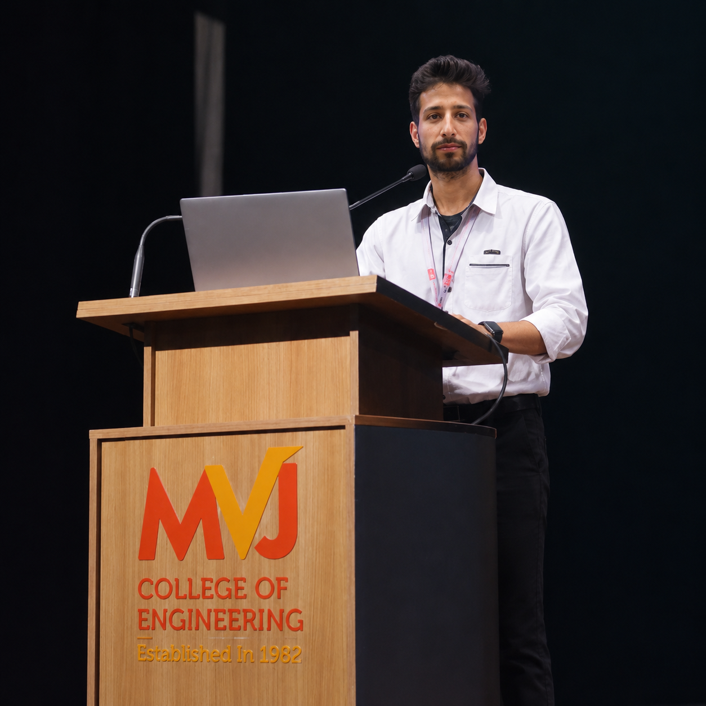

# Arshid Ahmad Malik — Engineering Portfolio

  

<strong>Electronics &amp; Communication Engineering graduate building practical technology across embedded systems, IoT, Android, AI-assisted applications, and EV technology.</strong>

  
  
  
  

## About

This repository contains the personal portfolio of **Arshid Ahmad Malik**, an Electronics and Communication Engineering graduate based in Bengaluru, Karnataka, India. It presents an engineering-focused profile spanning hardware-software integration, connected devices, Android development, generative-AI exploration, digital design fundamentals, and EV charging technology.

The site gives recruiters, collaborators, and fellow engineers one clear place to review professional interests, learning experience, project work, education, certificates, resume, and contact details.

## Portfolio highlights

- A focused hero, profile, and contact experience with direct GitHub, LinkedIn, email, and resume access.
- Skills organised by practical experience and foundational knowledge.
- Data-driven project cards covering embedded systems, electronics, IoT, robotics, Android development, AI-assisted applications, and this portfolio.
- Dedicated experience, education, certificate, and resume sections.
- Searchable/filterable certificate gallery that preserves available view and download actions.
- Responsive layouts for mobile through desktop, with keyboard-accessible controls and reduced-motion support.
- Semantic metadata, structured person data, canonical URL, social sharing metadata, favicon, and crawler instructions.

## Technical skills and interests

Skill labels in the portfolio distinguish **Practical Experience** from **Foundational Knowledge**.

| Area | Verified technologies and topics |
| --- | --- |
| Programming & software | C, C++, Kotlin, HTML, CSS, JavaScript; foundational Python, Java, TypeScript, and Verilog HDL |
| Android development | Android Studio, Kotlin, Jetpack Compose, Material 3, Firebase fundamentals |
| Embedded systems & electronics | ESP32, Arduino, NodeMCU, microcontrollers, sensors, actuators, relay interfacing, hardware debugging and testing |
| IoT & automation | Sensor data collection, embedded connectivity, Blynk IoT Platform, connected-device workflows, MQTT and IoT protocol fundamentals |
| AI-assisted development | Gemini and generative-AI integration, Google AI Studio, AI-assisted development, prompt-engineering fundamentals |
| Engineering tools | Git, GitHub, VS Code, multimeter and lab-instrument use |
| EV technology | Charging infrastructure, battery-technology exposure, sustainable mobility, and charging-standard fundamentals |

## Projects

Project content is maintained in [`src/data/projects.ts`](src/data/projects.ts). All listed entries are presented as completed in the portfolio; repository and demo buttons appear only when verified links exist.

| Project | Purpose and implementation | Technologies |
| --- | --- | --- |
| Solar Solution — Indoor Air Purifier for Urban Areas | Embedded monitoring and purification prototype that combines air-quality sensing, threshold-based relay control, filtering, LCD telemetry, and solar-power integration. | ESP32, MQ135, optical dust sensor, DHT11, relay module, LCD I2C, solar panel |
| NutriSnap — AI Food Diary | Android concept for photographed-meal analysis and structured nutrition journaling with multimodal AI. | Kotlin, Jetpack Compose, Gemini API, Firebase |
| Obstacle-Avoiding Robot with Lane Detector | Autonomous robot prototype combining ultrasonic collision avoidance with infrared lane tracking and differential motor control. | Arduino/ESP32, HC-SR04, IR sensors, L298N, C/C++ |
| Namma Santhe Ledger | Lightweight Android ledger for local-vendor income, expenses, summaries, and offline-friendly record keeping. | Kotlin, Jetpack Compose, Material 3 |
| Aircraft Monitoring System | Educational digital-electronics project for telemetry thresholds, warning states, and test-oriented logic. | Verilog HDL, digital logic, simulation testbenches |
| Blynk Home Automation | Connected-device prototype for remotely switching and monitoring household loads. | ESP32/NodeMCU, Blynk, relay module, Wi-Fi, C/C++ |
| Automatic Door Lock | Embedded access-control prototype with credential input, actuator control, display feedback, and lockout logic. | Arduino, keypad, servo/solenoid driver, LCD, C/C++ |
| Health Monitoring System | Sensor-instrumentation prototype for presenting pulse and temperature telemetry on an LCD. | ESP32/Arduino, pulse sensor/MAX30102, temperature sensor, LCD, C/C++ |
| Smart Helmet | Electronics safety prototype exploring alcohol sensing, wear detection, alerts, and control logic. | Arduino/ESP32, MQ-3, touch/limit sensors, buzzer, C/C++ |
| Personal Portfolio Website | The responsive website in this repository. | React, TypeScript, Vite, Tailwind CSS, Lucide React, Radix UI |

## Education and professional development

**Bachelor of Engineering, Electronics and Communication Engineering** — MVJ College of Engineering, Bengaluru; affiliated with Visvesvaraya Technological University (2023–2026).

**Diploma, Electronics and Communication Engineering** — Government Polytechnic College, Srinagar (2020–2023).

The portfolio also documents internships and structured training with CODEC Technologies, Emertxe, MindMatrix, VLSIGuru, and VisionAstraa EV Academy with TERI. These records are presented as internships or training—not as unverified employment claims—and are backed by the descriptions in [`src/data/experience.ts`](src/data/experience.ts).

The certificate gallery records learning across electronics, IoT, AI, data, cloud, cybersecurity, EV technology, communication, and participation. Available source documents keep their original view/download actions; items without a stored original document are not presented as verified files.

## Website technology

This portfolio is built with **React 18**, **TypeScript**, **Vite**, **Tailwind CSS**, HTML, CSS, and npm. It uses reusable component primitives from Radix UI, Lucide icons, React Router, and related packages listed in [`package.json`](package.json). Git and GitHub are used for source control and publication.

These are the technologies used to build the website. They are distinct from the engineering tools and technologies documented as personal learning or project experience above.

## GitHub activity

  
  

These optional cards are supplied by a third-party public statistics service and may be unavailable temporarily without affecting the portfolio itself.

## Connect

- **Live portfolio:** [arshid-portfolio.vercel.app](https://arshid-portfolio.vercel.app/)
- **GitHub profile:** [github.com/malikarshid01430-byte](https://github.com/malikarshid01430-byte)
- **Repository:** [github.com/malikarshid01430-byte/arshid-portfolio](https://github.com/malikarshid01430-byte/arshid-portfolio)
- **LinkedIn:** [linkedin.com/in/arshid-ahmad-malik](https://www.linkedin.com/in/arshid-ahmad-malik)
- **Email:** [malikarshid01430@gmail.com](mailto:malikarshid01430@gmail.com)

Arshid is committed to continuous learning, thoughtful engineering, practical innovation, and collaboration on meaningful technology work.
